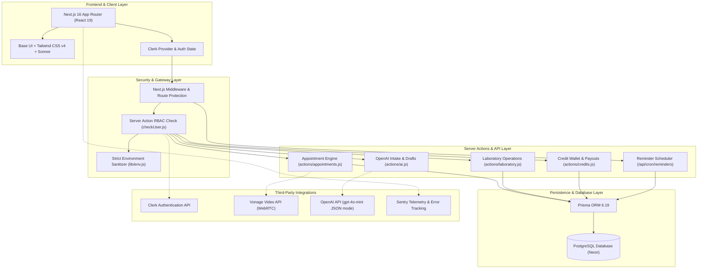

# Chikitsaak (चिकित्सक) — Intelligent Telehealth & Clinical Network

[](https://www.chikitsaak.in)
[](https://nextjs.org/)
[](https://react.dev/)
[](https://www.prisma.io/)
[](https://www.postgresql.org/)
[](https://clerk.com/)
[](https://www.vonage.com/)
[](https://openai.com/)
[](https://tailwindcss.com/)
[](https://playwright.dev/)

> **Chikitsaak** (derived from the Sanskrit word *चिकित्सक* for physician/healer) is an enterprise-grade digital healthcare platform connecting patients, accredited medical specialists, diagnostic pathology laboratories, and pharmacies. Built with Next.js 16 App Router, React 19, and PostgreSQL, the platform delivers peer-to-peer WebRTC video visits, AI-augmented clinical intake, role-isolated dashboards, and laboratory testing workflows.

---

## 🌐 Live Production Deployment

- **Production URL**: [https://www.chikitsaak.in](https://www.chikitsaak.in)
- **Source Code Repository**: [https://github.com/Rishikesh8447/Chikitsaak](https://github.com/Rishikesh8447/Chikitsaak)
- **Primary Branch for Pre-Release Staging**: `pre-deployment-fixes`

---

## 🌟 Core Highlights & Problem Statement

Modern healthcare delivery often suffers from fragmented patient records, inefficient clinician schedules, impersonal teleconsultation interfaces, and isolated pathology test ordering. Chikitsaak unites the entire outpatient journey into a unified digital ecosystem:

1. **Integrated Care Continuum**: Seamless transition from doctor discovery to appointment booking, AI-assisted intake, high-definition video consultation, prescription issuance, and lab diagnostic dispatch.
2. **AI-Assisted Clinical Workflows**: Zero-latency structured clinical summaries (`gpt-4o-mini` with strict Zod validation) capturing patient history before the call, followed by instant draft generation of clinical notes for doctors.
3. **WebRTC Telehealth Rooms**: Native video consultation rooms powered by the Vonage Video API with secure token authorization, end-to-end media channels, and patient-doctor access guards.
4. **Diagnostic Laboratory Lifecycle**: Full laboratory catalog management, offering pricing, test dispatch, specimen tracking, pathology test report uploads, and tamper-evident audit events.
5. **Role-Based Operational Security**: Multi-role platform architecture enforcing strict role isolation (Patient, Doctor, Administrator, Laboratory, Pharmacy) via Clerk authentication and Server Action access guards.

---

## 👥 Role-Based Capabilities

| Role | Key Capabilities & Implemented Routes | Primary Workflows |
| :--- | :--- | :--- |
| **Patient** | • Doctor directory browsing (`/doctors`)<br>• Real-time slot booking & calendar (`/appointments`)<br>• Consultation credits & subscription plan (`/credits`)<br>• Pre-consultation AI intake form (`/video-call/[id]` preview)<br>• WebRTC telehealth call (`/video-call/[id]`)<br>• Medical record & prescription repository (`/medical-records`)<br>• Diagnostic laboratory booking (`/laboratory`) | Finds accredited clinicians, books appointment slots via credits, completes AI intake questionnaires, connects to real-time video consults, and retrieves digital prescriptions and lab reports. |
| **Doctor** | • Verified practitioner workspace (`/doctor`)<br>• Weekly availability scheduling & slot buffer rules<br>• Patient queue management & medical history review<br>• In-consultation AI clinical note drafts<br>• Digital prescription creation & drug dosage schedules<br>• Credit earnings tracker & payout requests (`/doctor`) | Sets schedule availability, accepts appointments, reviews pre-generated patient AI summaries, conducts video appointments, issues signed prescriptions, and requests earnings payouts. |
| **Administrator** | • Central administrative console (`/admin`)<br>• Doctor verification & credential approval/rejection<br>• User role governance & account assignment<br>• Financial oversight & doctor payout disbursement<br>• Diagnostic laboratory partner management<br>• Platform-wide operational analytics (`/admin`) | Validates clinician medical licenses, approves or revokes provider privileges, audits credit transactions, processes clinician PayPal payouts, and manages system-wide operations. |
| **Laboratory** | • Diagnostic lab control center (`/laboratory`)<br>• Test catalog & test price configuration<br>• Lab order ingestion & specimen collection tracking<br>• Pathology status transitions with audit logs<br>• Report upload and patient notification | Publishes diagnostic offerings, accepts pathology orders, updates specimen lifecycle (Ordered → Collected → Processing → Completed), and uploads verified laboratory reports. |
| **Pharmacy** | • Dedicated medication management<br>• Standardized prescription consumption<br>• Medication dispensing records & dosage clarity | Reviews digital prescriptions generated by clinicians to support streamlined pharmaceutical fulfillment. |

---

## 🏗️ System Architecture



---

## 🔄 End-to-End Core Workflows

### 1. Appointment & Telehealth Consultation Workflow
1. **Discovery & Selection**: The patient searches the verified doctor catalog by medical specialty, language, and consultation fee.
2. **Slot Allocation**: The patient selects an open timeslot. The server verifies sufficient credit wallet balance, deducts the fee atomically, and marks the slot as `SCHEDULED`.
3. **Vonage Room Creation**: When the appointment is confirmed, the server initializes a unique Vonage Video session ID (`videoSessionId`) and stores it against the appointment record.
4. **Pre-Consultation Intake**: Prior to joining, the patient submits current symptoms, duration, and medical history. The OpenAI pipeline parses and validates this into a concise clinical brief.
5. **Secure Teleconsultation**: Both patient and clinician enter the video call route (`/video-call/[id]`). The server verifies participation authorization and generates short-lived, role-scoped WebRTC tokens.
6. **Prescription & Completion**: The clinician completes consultation notes (optionally using the AI-drafted template), issues digital prescriptions, and finalizes the appointment status to `COMPLETED`.

### 2. AI-Powered Clinical Intake & Note Generation
- **Intake Pipeline**: Patient answers are sent to `generatePatientSummary()` using `gpt-4o-mini` with temperature `0.2` and structured JSON extraction. The output is validated against `patientSummarySchema` (primary concerns, symptom timeline, severity rating, and relevant medical history).
- **Clinical Note Drafts**: Clinicians can trigger `generateDoctorDraft()` during or immediately following a visit. The engine analyzes the pre-consultation intake together with doctor observations to output formatted subjective/objective assessments, diagnostic considerations, and suggested follow-up intervals.

### 3. Diagnostic Laboratory Network & Specimen Tracking
- **Catalog Management**: Laboratories define offerings linked to standardized tests (e.g., Complete Blood Count, Lipid Profile, Thyroid Panel).
- **Order Lifecycle**: When a lab order is created, it transitions through non-destructive status milestones:
  $$\text{ORDERED} \longrightarrow \text{SAMPLE\_COLLECTED} \longrightarrow \text{PROCESSING} \longrightarrow \text{COMPLETED}$$
- **Audit Trails**: Every state change records a `LaboratoryAuditEvent` capturing timestamp, acting user ID, previous state, new state, and relevant metadata.

### 4. Financial Credits & Doctor Payout Lifecycle
- **Subscription-Based Credits**: Patients receive an initial 2-credit welcome grant upon account initialization, followed by monthly credit allocations tied to verified Clerk subscription tiers (`standard` with 10 credits/month, `premium` with 24 credits/month).
- **Consultation Hold & Settlement**: Credits are debited atomically upon appointment confirmation and credited to the clinician's balance upon consultation completion.
- **PayPal Payout Disbursements**: Clinicians with completed appointments can submit withdrawal requests for eligible earnings to their registered PayPal address ($10 per credit: $8 doctor earnings, $2 platform fee). Administrators review, approve, and record transaction reference codes.

---

## 💻 Complete Technology Stack

| Category | Technology | Version | Purpose / Architecture Role |
| :--- | :--- | :--- | :--- |
| **Framework** | [Next.js](https://nextjs.org/) | `16.2.10` | Full-stack React framework with App Router, Server Components, and Server Actions |
| **UI Runtime** | [React](https://react.dev/) | `19.2.4` | Modern component architecture, server actions, and concurrent rendering features |
| **Component Primitives** | [@base-ui/react](https://base-ui.com/) | `^1.6.0` | Accessible, unstyled component primitives for accessible dialogs, popovers, and menus |
| **Styling** | [Tailwind CSS](https://tailwindcss.com/) | `^4.0.0` | High-performance CSS engine with modern color schemes and responsive utilities |
| **Icons & Assets** | [Lucide React](https://lucide.dev/) | `^1.24.0` | Crisp, accessible icon set designed for medical and administrative workflows |
| **Database & ORM** | [Prisma](https://www.prisma.io/) | `^6.19.3` | Next-generation TypeScript/JavaScript ORM for schema definitions and migrations |
| **Database Engine** | [PostgreSQL (Neon)](https://neon.tech/) | Serverless | Scalable relational database with transactional integrity and connection pooling |
| **Authentication** | [Clerk](https://clerk.com/) | `^7.5.18` | Identity management, MFA, secure session tokens, and user metadata management |
| **Video Infrastructure** | [@vonage/server-sdk](https://www.vonage.com/) | `^3.29.0` | WebRTC session creation and token minting for private teleconsultation calls |
| **Artificial Intelligence** | [OpenAI](https://openai.com/) | `gpt-4o-mini` | Low-latency clinical intelligence with JSON mode and schema validation via Zod |
| **Schema Validation** | [Zod](https://zod.dev/) | `^4.4.3` | Type-safe schema validation for form submissions, API payloads, and AI outputs |
| **Monitoring** | [@sentry/nextjs](https://sentry.io/) | `^10.73.0` | Real-time performance monitoring, breadcrumbs, and exception tracking |
| **E2E & Visual Testing** | [Playwright](https://playwright.dev/) | `^1.63.0` | End-to-end browser automation, visual regression, and mobile viewport tests |
| **Accessibility Audit** | [@axe-core/playwright](https://github.com/dequelabs/axe-core) | `^4.13.0` | Automated accessibility test suite ensuring WCAG 2.1 compliance |
| **Performance CI** | [Lighthouse CI](https://github.com/GoogleChrome/lighthouse-ci) | `^0.15.1` | Automated audits for performance, SEO, progressive web features, and best practices |

---

## 📁 Project Directory Structure

```text
chikitsaak/
├── actions/                         # Next.js Server Actions (Role-gated mutations)
│   ├── admin.js                     # Doctor verification, user role updates, payout processing
│   ├── ai.js                        # OpenAI gpt-4o-mini structured summary and note draft engine
│   ├── analytics.js                 # Administrative metrics and revenue statistics
│   ├── appointments.js              # Booking, cancellation, slot allocation, and Vonage room minting
│   ├── credits.js                   # Credit allocation sync and Clerk subscription verification
│   ├── doctor.js                    # Clinician availability schedules and prescription creation
│   ├── doctors-listing.js           # Public directory queries with specialty filtering
│   ├── laboratory.js                # Laboratory catalogs, orders, status updates, and reports
│   ├── medical.js                   # Patient medical history and prescription queries
│   ├── notifications.js             # User in-app notifications and read state updates
│   ├── onboarding.js                # Post-signup role assignment and profile setup
│   ├── patient.js                   # Patient profile management and basic records
│   └── payout.js                    # Doctor PayPal withdrawal requests and balance eligibility
├── app/                             # Next.js App Router (Pages, layouts, route handlers)
│   ├── (auth)/                      # Clerk authentication routes (sign-in, sign-up)
│   ├── (main)/                      # Authenticated application domain routes
│   │   ├── admin/                   # Admin dashboard, verification queue, and user management
│   │   ├── appointments/            # Patient appointment view and scheduling flows
│   │   ├── contact-support/         # Support ticketing and customer help desk
│   │   ├── credits/                 # Credit balance and subscription plan inspection
│   │   ├── doctor/                  # Clinician schedule management and patient consultations
│   │   ├── doctors/                 # Practitioner directory search and profiles
│   │   ├── laboratory/              # Laboratory partner workspace and test tracking
│   │   ├── medical-records/         # Patient health records and prescription history
│   │   ├── onboarding/              # First-time profile creation and role assignment
│   │   └── video-call/[id]/         # WebRTC teleconsultation room powered by Vonage
│   ├── api/                         # HTTP route handlers
│   │   └── cron/                    # Scheduled background jobs
│   │       └── reminders/           # Automated appointment reminder notification dispatcher
│   ├── layout.js                    # Root layout with ThemeProvider, ClerkProvider, and Sonner
│   └── page.js                      # Public landing page with features, metrics, and CTA
├── components/                      # Modular UI components
│   ├── ui/                          # Reusable atomic UI elements (Buttons, Dialogs, Cards)
│   ├── header.jsx                   # Global responsive navigation header with role awareness
│   ├── bottom-nav.jsx               # Mobile-optimized bottom navigation with role switching
│   └── video-call.jsx               # Vonage WebRTC subscriber/publisher viewport component
├── lib/                             # Core utilities and library configurations
│   ├── ai.js                        # OpenAI SDK client initialization and prompt templates
│   ├── appointment-cancellation.mjs # Cancellation penalty rules and slot reclamation
│   ├── appointment-lifecycle.mjs    # State machine for appointment transitions
│   ├── checkUser.js                 # Authentication session validation and User syncing
│   ├── env.js                       # Environment variable validator (zero secret exposure)
│   ├── laboratory-workflow.mjs      # Specimen status progression and state checks
│   ├── payout-eligibility.mjs       # Clinician earnings calculation and withdrawal guards
│   └── prisma.js                    # Global Prisma client singleton instance
├── prisma/                          # Database schema and migration engine
│   ├── schema.prisma                # Relational data schema (Users, Appointments, Labs, Credits)
│   └── seed.js                      # Database seeding script for local development
├── public/                          # Static assets, branding, and icons
└── tests/                           # Automated test suites
    ├── accessibility.spec.js        # Axe Core accessibility verification
    ├── visual.spec.js               # Playwright visual regression tests
    └── end-to-end/                  # Role-based functional test flows
```

---

## 🚀 Installation & Local Development Setup

Follow these steps to set up and run the Chikitsaak development environment locally:

### 1. Prerequisites
- **Node.js**: `v20.x` or higher
- **Package Manager**: `npm` (v10+ recommended)
- **Database**: PostgreSQL (local instance or a cloud database like Neon)
- **Clerk Account**: For identity management credentials
- **Vonage Developer Account**: For Video API Application ID and private key
- **OpenAI Account**: For `gpt-4o-mini` API access

### 2. Clone the Repository
```bash
git clone https://github.com/Rishikesh8447/Chikitsaak.git
cd Chikitsaak
git checkout pre-deployment-fixes
```

### 3. Install Dependencies
```bash
npm install
```
*(This automatically runs `prisma generate` via the postinstall script).*

### 4. Configure Environment Variables
Create a `.env.local` file in the project root:
```bash
cp .env.example .env.local
```
*(Populate all required variables according to the [Environment Variables](#-environment-variables-reference) section below).*

### 5. Initialize the Database
Run migrations to create database tables, then seed initial data:
```bash
# Push schema or apply migrations
npx prisma migrate deploy

# (Optional) Seed test data and categories
npm run db:seed
```

### 6. Launch the Local Development Server
```bash
npm run dev
```
Open [http://localhost:3000](http://localhost:3000) in your browser.

---

## 🔐 Environment Variables Reference

Chikitsaak includes an environment validation utility (`lib/env.js`) to verify required credentials without exposing secret values in logs or client bundles.

| Variable Name | Required | Scope | Description |
| :--- | :---: | :--- | :--- |
| `DATABASE_URL` | Yes | Server | PostgreSQL connection string (supports Neon pooled URLs with SSL). |
| `NEXT_PUBLIC_CLERK_PUBLISHABLE_KEY` | Yes | Client & Server | Browser-safe Clerk publishable key for client-side authentication. |
| `CLERK_SECRET_KEY` | Yes | Server | Server-only Clerk API key for session validation and webhook verification. |
| `NEXT_PUBLIC_VONAGE_APPLICATION_ID` | Yes | Client & Server | Vonage Application ID used to initialize WebRTC video sessions. |
| `VONAGE_PRIVATE_KEY` | Yes | Server | Private key (PEM format or multiline string) to sign Vonage video tokens. |
| `OPENAI_API_KEY` | Yes | Server | OpenAI secret key used for pre-consultation intake and clinical drafting. |
| `OPENAI_MODEL` | No | Server | Target OpenAI model name (defaults to `gpt-4o-mini` if omitted). |
| `CRON_SECRET` | Yes | Server | Secret bearer token required to authorize `/api/cron/reminders`. |
| `NEXT_PUBLIC_APP_URL` | No | Client & Server | Base URL of the deployment (e.g. `https://www.chikitsaak.in`). |

> [!CAUTION]
> Never commit actual credentials, secret keys, or `.env.local` files to version control. Always configure secret values directly in your hosting platform dashboard (e.g., Vercel Project Settings).

---

## 🧪 Testing, Quality Assurance & Verification

The codebase includes automated test suites covering end-to-end functionality, accessibility compliance, visual regressions, and static analysis:

```bash
# 1. Run ESLint static code analysis
npm run lint

# 2. Run full Playwright End-to-End test suite
npm run test:e2e

# 3. Run visual regression test suite
npm run test:visual

# 4. Run automated accessibility (a11y) checks with Axe Core
npm run test:a11y

# 5. Run Lighthouse CI performance and best practices audit
npm run lighthouse:ci
```

---

## 🛡️ Security, Privacy & Compliance Architecture

- **Server-Side Session Validation**: All Server Actions enforce session authenticity via `checkUser.js`. User records are matched against internal database IDs to prevent identity spoofing.
- **Strict Role Isolation**: API endpoints and page layouts enforce role-based access control (RBAC). Patients cannot invoke doctor-specific mutations, and non-administrators cannot trigger verification or payout actions.
- **Protected Teleconsultation Rooms**: Vonage Video sessions are accessible only to the specific patient and clinician assigned to the appointment record. WebRTC session tokens expire automatically.
- **Non-Destructive State Machines**: Financial transactions, appointment status transitions, and pathology specimen milestones are tracked sequentially with audit events (`LaboratoryAuditEvent`, `LabOrderStatusHistory`).
- **Sanitized AI Prompts**: OpenAI API requests utilize temperature damping (`0.2`), strict JSON schema enforcement via Zod, and omit unnecessary personally identifiable information.

---

## 👨‍💻 Author & Connect

**Rishikesh Patel**  
- **GitHub**: [@Rishikesh8447](https://github.com/Rishikesh8447)  
- **Email**: [rishikeshpatel1199@gmail.com](mailto:rishikeshpatel1199@gmail.com)  
- **Project Repository**: [https://github.com/Rishikesh8447/Chikitsaak](https://github.com/Rishikesh8447/Chikitsaak)  
- **Live Platform**: [https://www.chikitsaak.in](https://www.chikitsaak.in)

---

## 📄 License

This project is licensed under the [MIT License](LICENSE).
