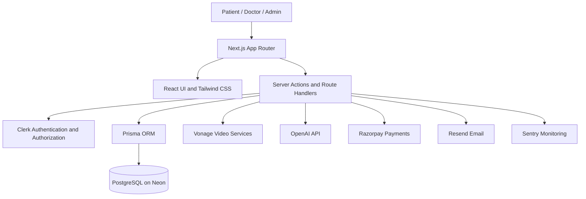

Chikitsaak — Digital Healthcare Platform

  <strong>A modern healthcare platform for connecting patients, doctors, and diagnostic laboratories.</strong>

  <!-- Replace or remove badges if your repository uses different tooling or coverage. -->
  
  
  
  
  

Project status: Update this section before publishing. State whether the project is in development, deployed, or production-ready, and link to the live application if one is available.

Table of Contents
- Overview
- Problem Statement
- Features
- Technology Stack
- Architecture
- User Roles
- Security and Reliability
- Getting Started
- Environment Variables
- Database Setup
- Available Scripts
- Testing and Quality Checks
- Deployment
- Project Structure
- Roadmap
- Contributing
- Author
Overview
Chikitsaak is a web-based healthcare platform designed to bring essential healthcare workflows into one application. It supports patient–doctor interactions, appointment scheduling, online consultations, prescriptions, notifications, and diagnostic laboratory workflows. The platform also includes role-aware access, doctor verification, and supporting administrative capabilities.

The project is built with Next.js and React, uses PostgreSQL for persistent data, and uses Prisma to manage database access. Authentication is handled through Clerk, while selected external services support video consultations, AI-assisted workflows, monitoring, and deployment.
Before publishing: Confirm which features are currently available in the deployed UI. Database models or integrations alone do not necessarily mean that every user workflow is complete.

Problem Statement
Healthcare services can be fragmented across appointment booking, consultations, prescriptions, and diagnostic testing. Chikitsaak aims to make these workflows easier to access and manage through a unified digital experience for patients, healthcare professionals, and administrators.
Features
Patient Experience
- Discover doctors and view available appointment slots.
- Book and manage appointments, subject to the implemented booking flow.
- Join supported online video consultations.
- Access prescription-related information where enabled.
- Receive in-app notifications for supported events.
- Submit reviews for eligible consultations, if enabled in the current UI.
Doctor Experience
- Create and maintain a doctor profile.
- Submit a profile for verification and view its verification status.
- Manage availability and appointments.
- Participate in supported video consultations.
- Create prescriptions and manage prescribed medicines.
- Access doctor-facing workflows according to role and verification permissions.
Laboratory Workflows
The database schema includes models for laboratories, memberships, laboratory offerings, lab tests, lab orders, order items, status history, and audit events.

Depending on the current application implementation, laboratory capabilities may include:
- Laboratory and test catalogue management.
- Laboratory-specific test offerings and pricing.
- Lab-test order creation and status tracking.
- Membership and audit-related workflows.
Verify the current UI and server actions before describing each item above as fully available to end users.
Payments and Credits
The project has included a credit and payout model and has had Razorpay payment integration work. Before publishing, confirm the current branch's implementation and configuration for:
- Online appointment checkout and server-side payment verification.
- Payment failure, cancellation, and recovery behavior.
- Credit transactions and balance updates.
- Doctor payout requests and approval/rejection handling.
- Optional webhook-based reconciliation, refunds, or delayed payment recovery.
Do not enable this section as a claim of a live payment service until the implementation and deployment configuration have been checked.
AI-Assisted Workflows
The project includes OpenAI integration for supported healthcare assistance, including consultation-related summaries or assistance. Describe the exact user-facing capabilities only after confirming the current implementation. AI-generated information should be reviewed by a qualified healthcare professional and should not be presented as a substitute for professional medical judgment.
Notifications and Reminders
The data model includes notifications and appointment reminder records. If configured in the current deployment, notification delivery may use in-app notifications and email services such as Resend.

Confirm which channels are currently wired up, what events trigger them, and whether reminder scheduling is active before advertising them as operational.
Progressive Web App (PWA)
Chikitsaak has been developed with PWA goals. Verify the current manifest, service worker, caching strategy, installation behavior, and update flow before claiming specific offline functionality.

Potential documentation points to confirm:
- Responsive, mobile-first layouts.
- Installability and standalone display behavior.
- Application manifest and icons.
- Service-worker registration and update behavior.
- Offline, loading, and error states.
- Cache strategy and data freshness.
Technology Stack
The following technologies have been used in the project. Verify the current package.json, source files, and deployment configuration before treating every integration as enabled in the current branch.
Area	Technology	Role
Application framework	Next.js (App Router)	Routing, rendering, and server-side application capabilities
UI library	React	Interactive user interfaces
Language	JavaScript / JSX	Application implementation
Styling	Tailwind CSS	Responsive styling and design utilities
UI components	shadcn/ui and Base UI primitives	Reusable interface components
Authentication	Clerk	Sign-in, identity, and session handling
Database	PostgreSQL	Persistent relational data
ORM	Prisma	Schema, queries, and database access
Database hosting	Neon (deployment-dependent)	Managed PostgreSQL hosting
Video	Vonage	Video session and token integration
AI	OpenAI API	Supported AI-assisted workflows
Payments	Razorpay (verify current branch)	Online payment integration
Email	Resend (verify current branch)	Transactional email delivery, if configured
Validation	Zod	Input and schema validation
Forms	React Hook Form	Form state and submission
Icons	Lucide React	Interface icons
Notifications	Sonner and application notification workflows	Toast feedback and notifications
Monitoring	Sentry	Error monitoring, if configured
Browser testing	Playwright	End-to-end and browser tests
Accessibility testing	axe-core with Playwright	Automated accessibility checks
Performance auditing	Lighthouse CI	Performance and quality audits
Linting	ESLint	Static code-quality checks
Hosting	Vercel (deployment-dependent)	Application deployment

Architecture
The high-level architecture is intended to follow this pattern. Adjust the diagram if the current implementation differs.

Architecture notes
- The UI is built with React and Next.js.
- Server-side operations should validate identity, permissions, and input before changing data.
- Prisma provides access to PostgreSQL.
- External integrations are optional/configuration-dependent and should only be enabled when their environment variables are set.
- Never expose secret API keys in client-side code or commit them to the repository.
User Roles
Patient
Uses the patient-facing workflows available in the application, such as doctor discovery, appointment management, consultations, and access to related medical information.
Doctor
Manages a doctor profile, availability, appointments, and consultation-related workflows, subject to the application's verification and authorization rules.
Administrator
Uses authorized administrative workflows to oversee the platform and manage applicable records or verification processes.
Document the exact permissions from the current server-side authorization logic. Hiding a button in the UI is not a substitute for server-side authorization.

Security and Reliability
Security-related measures and engineering practices in the project include, where enabled in the current branch:
- Clerk-based authentication and session handling.
- Role-aware access controls and doctor-verification checks.
- Server-side validation for sensitive operations.
- Security-related HTTP headers.
- Production HTTPS/HSTS configuration where supported by deployment.
- Environment-based configuration for external services.
- Sentry error monitoring.
- Automated browser, accessibility, and performance checks.
Security note: This README is not a security certification. Verify each control in the current source and production configuration before making a compliance or security guarantee. Do not commit .env files, API keys, database URLs, payment secrets, or private credentials.
Getting Started
Prerequisites
Install the following tools and services before starting:
- Node.js version compatible with the current project configuration.
- npm (or the package manager indicated by the repository lockfile).
- A PostgreSQL database, such as a Neon development database.
- A Clerk application for authentication.
- Credentials for any external service you intend to run locally, such as Vonage, OpenAI, Razorpay, or Resend.
1. Clone the repository
git clone https://github.com/Rishikesh8447/Chikitsaak.git
cd Chikitsaak
2. Install dependencies
npm install
3. Configure environment variables
Create a local .env file using the variable names documented in the repository's deployment guide and source code. Do not copy production secrets into a shared environment or commit the file.

See Environment Variables below.
4. Configure the database
Confirm that DATABASE_URL points to your development database, then use the migration workflow appropriate to the current branch:
npx prisma generate
npx prisma migrate deploy
Use prisma migrate deploy for applying existing migrations in a deployment-like environment. For local schema development, follow the project's established migration process; do not create, reset, or apply migrations against a production database without reviewing the migration plan and target database first.

If the project requires additional setup or seed commands, add the verified commands here.
5. Start the development server
npm run dev
Open http://localhost:3000 in your browser.
Environment Variables
Environment variable names and requirements can differ between branches. Use .env.example, the deployment guide, and references in the source code as the source of truth. The table below is a checklist, not a declaration that every variable is required in every environment.
Variable / group	Purpose	Status
DATABASE_URL	PostgreSQL connection string used by Prisma	Confirm exact format and whether a direct URL is also required
NEXT_PUBLIC_CLERK_PUBLISHABLE_KEY	Clerk client-side publishable key	Confirm against current Clerk configuration
CLERK_SECRET_KEY	Clerk server-side secret	Confirm against current Clerk configuration
Clerk redirect / route variables	Sign-in, sign-up, or post-authentication routing	Use only names referenced by the current source
Vonage credentials and application settings	Video session/token integration	Confirm exact names and required values
OpenAI API key	AI-assisted features	Confirm exact name and feature requirements
Razorpay keys and webhook secret	Payment checkout, verification, and optional webhook handling	Confirm exact names and test/live mode requirements
Resend API key and sender configuration	Email delivery	Confirm exact names and verified sender requirements
Sentry DSN and environment settings	Error monitoring	Confirm whether required or optional
Reminder endpoint secret	Protects an authenticated reminder endpoint, if used	Use the exact name documented by the current deployment guide

Do not paste real values into this README. If possible, maintain a sanitized .env.example containing variable names and safe placeholder values.
Database Setup
Chikitsaak uses Prisma to model and access PostgreSQL data.

The schema includes entities for areas such as:
- Users, roles, and doctor verification.
- Appointments and availability.
- Prescriptions and prescribed medicines.
- Reviews and notifications.
- Appointment reminders.
- Credit transactions and payouts.
- Laboratories, memberships, lab tests, offerings, and lab orders.
- Order status history and audit events.
Useful commands:
npx prisma generate
npx prisma migrate status
To inspect the schema visually in a development environment:
npx prisma studio
Run database commands only against the intended environment. Review the migration history and target database before applying schema changes.
Available Scripts
The repository's package.json is the definitive source for available scripts. Start by checking it:
npm run
Common development commands include:
npm run dev
npm run build
npm run start
npm run lint
Use only commands that exist in the current package.json. Add the project's exact test, accessibility, visual-test, and Lighthouse CI commands here after confirming their current names and prerequisites.
Testing and Quality Checks
The project has used Playwright and related tooling for browser-level testing, accessibility checks, and performance audits.

Before a release, a useful verification sequence is:
1. Run linting.
2. Run relevant unit or integration tests, if configured.
3. Run targeted Playwright tests against the intended test environment.
4. Run accessibility checks.
5. Run Lighthouse CI where configured.
6. Verify a production build.
7. Test the main patient, doctor, and admin workflows with appropriate test accounts.
8. Verify external integrations in test mode before enabling production credentials.
Document exact commands and actual test coverage based on the current repository. Do not describe a test as passing unless it has been run successfully.
Deployment
Chikitsaak has used Vercel and PostgreSQL hosting for deployment. Confirm the current production branch, domain, and deployment state before publishing live links or claiming production availability.

Deployment checklist:
1. Configure the production database and verify the migration history.
2. Set required environment variables in the hosting provider.
3. Configure Clerk production domains and redirect URLs.
4. Configure external-service credentials and callback/webhook URLs as applicable.
5. Apply reviewed database migrations using the project's release process.
6. Build and deploy the intended commit.
7. Verify authentication, role permissions, appointments, and core user journeys.
8. Verify logs, error monitoring, and any scheduled reminder tasks.
9. Confirm payment verification and webhook behavior before accepting live payments.
10. Confirm PWA installation and update behavior if enabled.
Consult [`DEPLOYMENT.md`](./DEPLOYMENT.md) for repository-specific deployment guidance and keep that guide synchronized with this README.
Project Structure
The following is a high-level guide. Update it to match the exact directory structure in the branch you are documenting.
Chikitsaak/
├── app/                  # Next.js App Router pages, layouts, and route segments
├── actions/              # Server actions and application operations
├── components/            # Shared UI and feature components
├── prisma/                # Prisma schema and database migrations
├── public/                # Static assets and public files
├── tests/                 # Automated tests, if present in this branch
├── DEPLOYMENT.md          # Deployment guidance
├── next.config.mjs        # Next.js configuration
├── package.json           # Dependencies and npm scripts
└── README.md              # Project documentation
Roadmap
Update this list to reflect actual project priorities. Potential future improvements include:
- Improve coverage of critical appointment and consultation lifecycle scenarios.
- Continue improving mobile usability and PWA behavior.
- Expand accessibility and performance regression checks.
- Improve operational visibility for notification delivery and external integrations.
- Complete or refine laboratory and pharmacy workflows based on project scope.
Remove any roadmap item that is already completed or no longer planned.
Contributing
Contributions and suggestions are welcome.
1. Fork the repository.
2. Create a focused feature branch.
3. Make changes that match the project's existing architecture and conventions.
4. Run relevant linting and tests.
5. Submit a pull request with a clear description of the changes and test results.
For significant changes, discuss the intended approach before changing authentication, payment handling, database schema, migrations, or other sensitive workflows.
Author
Rishikesh Patel
- GitHub: @Rishikesh8447
- Project repository: Chikitsaak

  Built to make digital healthcare workflows more accessible and manageable.

